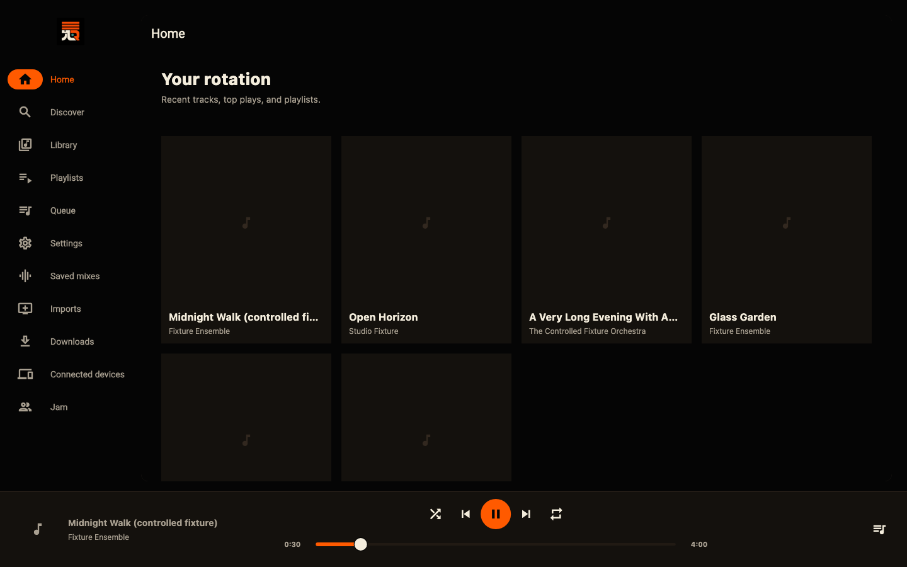
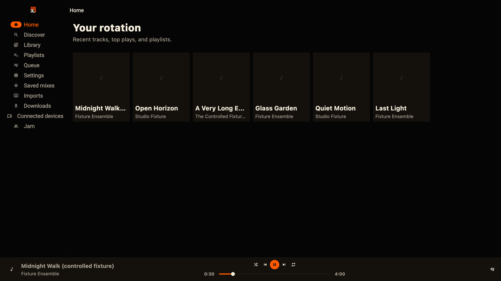
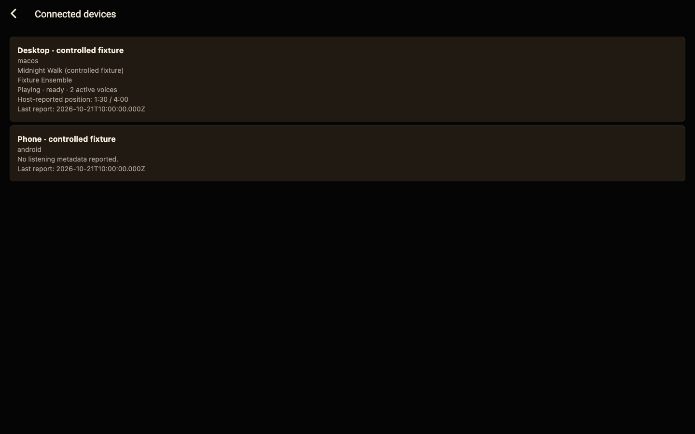
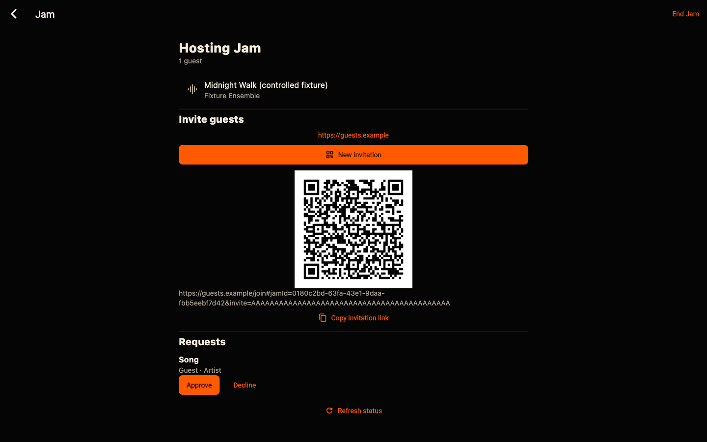
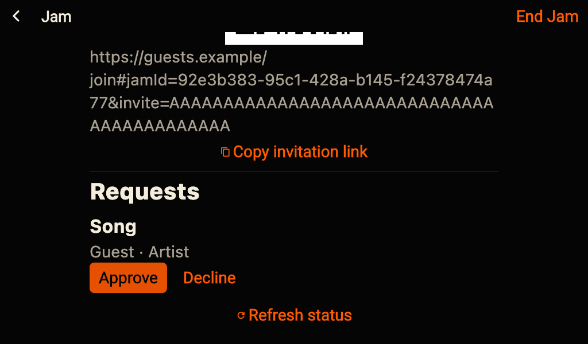
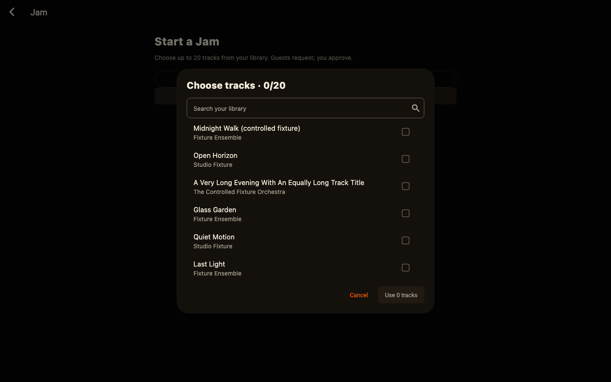

# Desktop page captures

These are actual Flutter production-route renders using controlled fixtures and real fonts, not a production account or a design mockup. No artwork is included in the fixture. The invitation uses a reserved `.example` origin and dummy capability. QR rendering does not establish public hosting.

## Home, 1440×900, 1× text

## Home, 2560×1440, 2× text

## Connected devices

## Jam invitation

## Jam requests, compact window, 2× text

## Library picker

The rendered matrix covers 1024×600, 1024×768, 1440×900 and 2560×1440 at 1×/2× text. It checks keyboard navigation, scroll reachability, dialog coverage and minimum action targets. All eight invitation QR extracts independently decoded to the fixture link. See `docs/DESKTOP_DELIVERY.md` for runtime and shipping limits.
